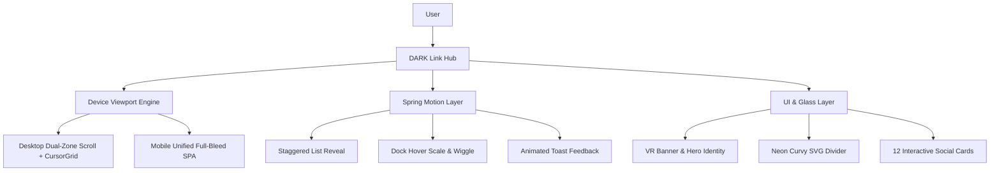
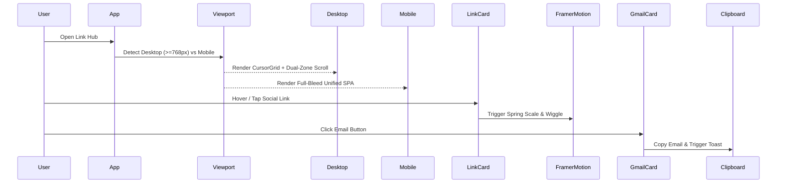
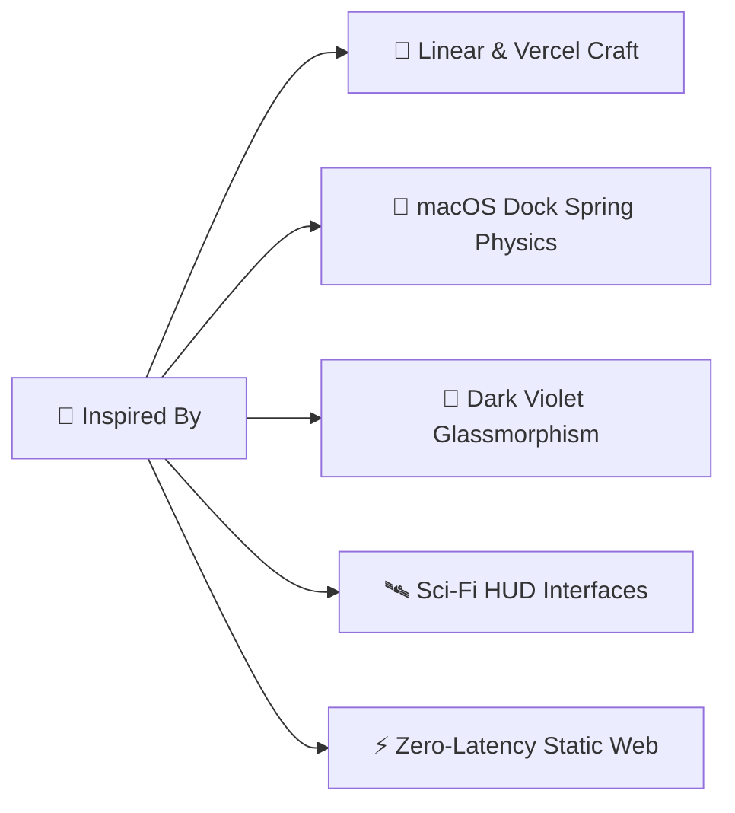

<div align="center">


<pre>
██╗   ██╗██╗███╗   ██╗ █████╗  █████╗ ██╗         ██████╗ 
██║   ██║██║████╗  ██║██╔══██╗██╔══██╗██║         ██╔══██╗
██║   ██║██║██╔██╗ ██║███████║███████║██║         ██████╔╝
╚██╗ ██╔╝██║██║╚██╗██║██╔══██║██╔══██║██║         ██╔══██╗
 ╚████╔╝ ██║██║ ╚████║██║  ██║██║  ██║███████╗    ██║  ██║
  ╚═══╝  ╚═╝╚═╝  ╚═══╝╚═╝  ╚═╝╚═╝  ╚═╝╚══════╝    ╚═╝  ╚═╝
</pre>

<br> 


<br><br>


<br><br>

<a href="https://darkxzz.netlify.app/">
  
</a>

<a href="https://github.com/Dark-Vinaal/Link_tree">
  
</a>

<br><br>

 

</div>

<div align="center">  </div>

## 🌌 DARK Link Hub (Custom Linktree)

> A bespoke, high-craft digital identity hub and Linktree alternative engineered with liquid glassmorphism, spring physics, interactive cursor grids, and zero paywalls.

<div align="center">  </div>

## ⚡ Overview

This custom Linktree platform is engineered to deliver a flagship, tactile social hub experience with:
- liquid purple glassmorphism & ambient radial lighting
- macOS dock-style spring hover physics & sustained-hover wiggle animations
- interactive cursor-tracking grid background (`CursorGrid`) on desktop
- dual-zone desktop scroll routing & native unified mobile scroll
- instant one-click Gmail copy-to-clipboard with toast notifications
- glowing SVG wave dividers & smooth mask-image edge blending
- zero third-party SaaS limits, hosted free on Netlify

The project reflects:
- 🧠 precision UI engineering
- ⚡ tactile spring physics
- 🎨 bespoke dark-purple aesthetics
- 🚀 high-performance static deployment

<div align="center">  </div>

## 🧠 Tech Stack

<div align="center">


</div>

<div align="center">  </div>

## ⚛️ Core Technologies

| Technology | Usage |
|---|---|
| React | Component Architecture & State Management |
| Vite | Lightning-Fast Bundling & Dev Server |
| Tailwind CSS | Utility Layout & Icon Sizing |
| Custom CSS3 | Liquid Glassmorphism, Radial Gradients & Mask Blending |
| Framer Motion | Spring Physics, Staggered Entrances & Wiggle Animations |
| Lucide React | Crisp UI Action & Status Icons |
| Custom Brand SVGs | Pixel-Sharp Vector Logos for 12 Social Platforms |

<div align="center">  </div>

## 🌌 Interface Architecture



<div align="center">  </div>

## 🚀 Core Features

<div align="center">

| ⚡ Feature                 | 🌌 Description                                              |
| ------------------------- | ----------------------------------------------------------- |
| 💜 Liquid Glass UI        | Deep violet radial gradients with translucent glass layers  |
| ⚛️ Tactile Micro-Physics  | Spring scale-up on hover + subtle vibration after 700ms     |
| 🖱️ Dual-Zone Scroll (PC)  | Scroll links independently or outer card via cursor zone    |
| 📱 Native Mobile SPA      | Edge-to-edge full-screen layout with natural touch scroll   |
| 📋 One-Tap Email Copy     | Copies Gmail address with emerald state & toast alert       |
| ✨ Interactive Grid       | Spotlight & area-highlight cursor grid on desktop viewports |
| 🌊 Neon Wave Divider      | Glowing SVG bezier curve separating identity & links        |
| 🔗 Native Web Share API   | Instant profile link sharing via system share sheet / copy  |

</div>

<div align="center">  </div>

## 🛰️ Hub Modules

### 🏠 Identity Header & VR Banner

- Edge-blended VR emblem banner
- Custom typography pairing (`Josefin Sans`, `Plus Jakarta Sans`, `JetBrains Mono`)
- Floating glassmorphic top utility bar (Welcome sparkle & Share trigger)

### 🌊 Neon Curvy Divider

- Custom SVG sine-wave separator
- Multi-stop purple-to-fuchsia gradient with ambient drop-shadow glow

### 🔗 Interactive Social Matrix (12 Platforms)

- **Social & Media:** Instagram, X (Twitter), Facebook, Threads, Reddit, Snapchat, Spotify
- **Developer & Community:** GitHub, LinkedIn, Discord, Telegram
- **Direct Contact:** Interactive Gmail card with instant clipboard copy & confirmation badge

### 🖱️ Desktop CursorGrid Canvas

- Interactive 60px spatial grid with spotlight illumination
- Area highlight trail and click-pulse ripple feedback

<div align="center">  </div>

## 🎨 UI Philosophy

```txt
Deep Void & Violet Gradients
        +
Liquid Glassmorphism
        +
Spring Micro-Interactions
        +
Adaptive Dual-Device Scroll
        +
Zero Paywall Bloat
        =
DARK LINK HUB
```

<div align="center">  </div>

## 🌍 Live Preview

<div align="center">

### 🚀 ACCESS LIVE LINK HUB

<a href="https://darkxzz.netlify.app/">
  
</a>

</div>

<div align="center">  </div>

## 📂 Project Structure

```txt
📦 Link_tree/
│
├── 📂 public/
├── 📂 src/
│   ├── 🎨 assets/
│   │   └── 🖼️ VR-Logo.png
│   ├── 🧩 components/
│   │   └── 🕸️ CursorGrid.jsx
│   ├── ⚛️ App.jsx
│   ├── 🎭 App.css
│   └── 🚀 main.jsx
├── ⚙️ netlify.toml
├── 📦 package.json
└── ⚡ vite.config.js
```

<div align="center">  </div>

## ⚛️ Interaction & Scroll Flow



<div align="center">  </div>

## 🌌 Design Inspiration



<div align="center">  </div>

## 🧠 Future Upgrades

- 🔗 Live social profile URLs & dynamic status badges
- 📊 Lightweight privacy-friendly click analytics
- 🎨 Switchable theme presets (Cyber Cyan / Void Purple)
- 📱 Custom QR code modal inside the top share menu
- ⚡ PWA support for instant home-screen installation

<div align="center">  </div>

## 👨‍🚀 Developer

<div align="center">

# Vinaal R

### Full-Stack Developer • UI Craftsman • Open-Source Builder


</div>

<div align="center">  </div>

## 🌐 Connect

<div align="center">

<a href="https://vinaalr.netlify.app/">
  
</a>
<a href="https://github.com/Dark-Vinaal">
  
</a>
<a href="https://www.linkedin.com/in/vinaal">
  
</a>
<a href="https://darkxzz.netlify.app/">
  
</a>

</div>

<div align="center">

 
